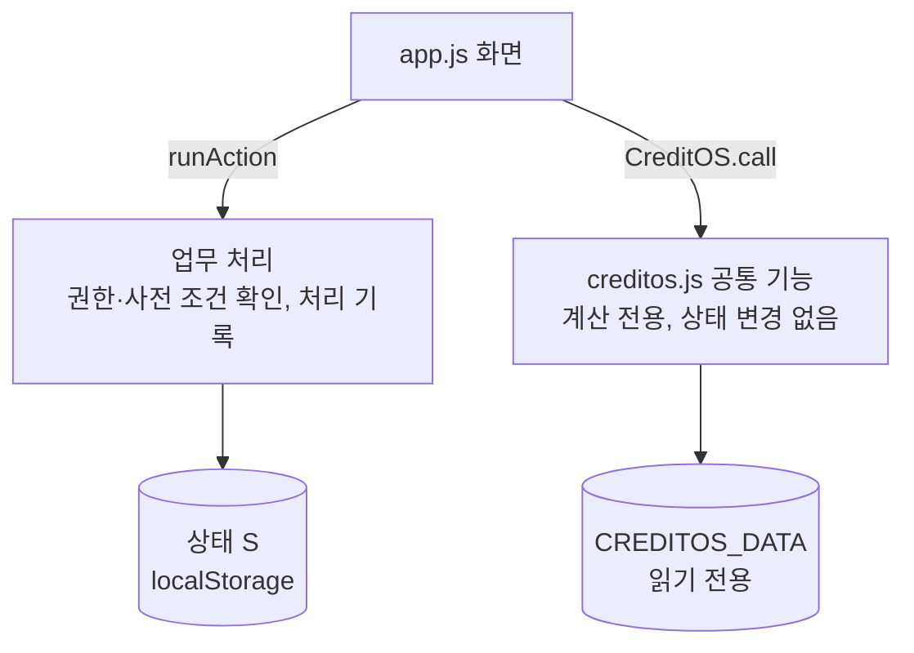

# 실행 구조

## 파일 구성

배포 파일 `index.html` 은 `<style>` 블록 1개와 `<script>` 블록 4개로 구성됩니다. 스크립트는 아래 순서로 실행되며 뒤 블록이 앞 블록의 전역 값을 사용합니다.

| 순서 | 원본 | 전역 이름 | 역할 |
|---|---|---|---|
| 1 | `src/data/dart.json` | `window.CREDITOS_DATA` | DART 공시 정보 |
| 2 | `src/data/seed.js` | `window.CREDITOS_SEED` | 가상 데이터 |
| 3 | `src/js/creditos.js` | `window.CreditOS` | 공통 기능, 기능 등록부 |
| 4 | `src/js/app.js` | 없음 | 화면, 경로 처리, 업무 처리, 상태 저장 |

| CSS 순서 | 역할 |
|---|---|
| `fonts.css` | 글꼴 선언 |
| `base.css` | 기본 레이아웃·구성 요소 |
| `theme.css` | 색상 변수와 색상 규칙 재지정 |
| `skin.css` | 업무 시스템 스타일(평면·고밀도), 900px·600px 이하 반응형 |

뒤 파일의 규칙이 앞 파일의 규칙에 우선합니다.

## 계층

| 원칙 | 내용 |
|---|---|
| 공통 기능 | 입력값 기반 계산만 수행, 화면 상태 변경 없음 |
| 기능 호출 | `CreditOS.call(name, 업무명, ...args)` 사용, 호출 업무·기능 버전을 `callLog` 에 기록 |
| 기능 내부 호출 | `sub(name, ...args)` 사용, 상위 호출의 업무명으로 기록 |
| 상태 변경 | `runAction(name, params)` 로만 수행, 처리 기록(`audit`) 저장 |

업무 처리 정의는 `allowed(user)`(실행 가능 역할), `pre(params)`(사전 조건, 불충족 사유 반환), `run(params)`(실행)로 구성됩니다.

## 상태

저장 위치: `localStorage["creditos-demo-v1"]`. 저장값이 없거나 손상된 경우 `seed.js` 기준으로 초기화합니다.

| 키 | 내용 |
|---|---|
| `role` | 현재 사용자 (`u1` 심사역, `u2` 심사팀장, `c1` 고객) |
| `cases` | 심사 건 (신규·만기연장), 자료 요청·의견·결정 포함 |
| `loans` | 실행 여신 |
| `tasks`, `events` | 모니터링 검토 업무, 사건 처리 상태 |
| `audit` | 처리 기록 |
| `scenario` | 심사 건별 상환여력 시나리오 입력값 |
| `evi` | 정보가치 계산 가정값 (화면에서 수정 가능) |
| `seq` | 일련번호 |

## 경로

해시 기반 경로(`#/<page>/<id>`). `hashchange` 발생 시 `render()` 로 화면 전체를 다시 그립니다.

| 해시 | 화면 함수 | 화면 |
|---|---|---|
| `#/home` | `pageHome` | 업무 현황 |
| `#/company/<corp_code>` | `pageCompany` | 기업 정보 |
| `#/case/<id>` | `pageCase` | 심사 화면 (신규·만기연장 공통) |
| `#/loans`, `#/loan/<id>` | `pageLoans`, `pageLoan` | 실행 여신 |
| `#/monitor` | `pageMonitor` | 사후 모니터링 |
| `#/packages` | `pagePackages` | 업무 기능 관리 |
| `#/audit` | `pageAudit` | 처리 기록 |
| `#/portal` | `pagePortal` | 고객 화면 (고객 전용) |

이벤트는 `document` 단위 위임 방식으로 처리합니다. 버튼 `data-act` 는 업무 처리 이름, 폼 `data-form` 은 처리 종류(`scenario`, `evi`, `opinion`, `decision`, `assign`, `close`, `submit`)입니다.

## 업무 처리

| 이름 | 내용 | 실행 역할 |
|---|---|---|
| `RequestDocument` | 고객 자료 요청 | 심사역, 심사팀장 |
| `SubmitDocument` | 요청 자료 제출 (파일명만 기록) | 고객 |
| `ReviewDocument` | 제출 자료 확인 완료 또는 보완 요청 | 심사역, 심사팀장 |
| `AssignReviewer` | 담당 심사역 배정 | 심사팀장 |
| `RecordOpinion` | 심사 의견 기록 | 심사역, 심사팀장 |
| `RecordDecision` | 승인·조건부 승인·거절. 전결 한도, 의견 기록, 필수 자료 확인 여부 사전 점검 | 전결 권한 보유자 |
| `StartRenewalReview` | 만기연장 심사 건 생성 (만기 60일 전부터) | 심사역, 심사팀장 |
| `CreateMonitoringTask` | 모니터링 사건의 검토 업무 등록 | 심사역, 심사팀장 |
| `CloseEvent` | 모니터링 사건 종결 (종결 사유 필수) | 심사역, 심사팀장 |

## 업무 패키지

`seed.js` 의 `packages` 에 업무별 구성(`requires` 선행 요소, `adds` 추가 요소)을 정의합니다.

| 패키지 | 상태 | 추가 기능 |
|---|---|---|
| 신규 운전자금 심사 (`new-credit`) | 사용 중 | summarizeDebt, calcRatios, validateFacts, checkAuthority, riskSignals, simulateRepayment, policyCheck, nextBestAction |
| 만기연장 심사 (`renewal`) | 사용 중 | checkCovenants |
| 공시 기반 사후 모니터링 (`monitoring`) | 시범 | detectMonitoringEvents |

만기연장·사후 모니터링은 신규 심사의 공통 기능을 재사용합니다.
