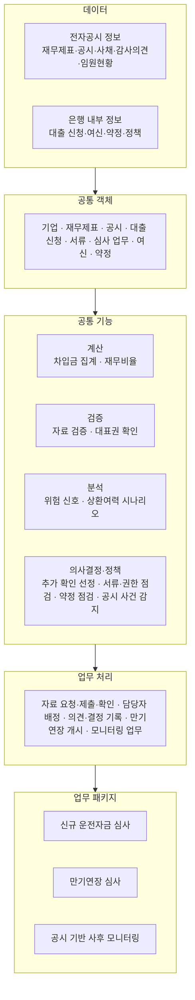

# 기업여신 비대면화의 어려움과 해결방안

| 항목 | 내용 |
|---|---|
| 대상 상품 | 중소법인 운전자금대출 |
| 분석 기준일 | 2026년 10월 13일 |
| 시연 페이지 | https://kjhoeakjy.github.io/nice/ |
| 데이터 | 전자공시시스템(DART) 공시 정보, 은행 내부 정보는 가상 데이터 |

**목차**

1. 개인 신용대출과 법인 운전자금대출의 처리 과정 비교
2. 기업 여신 비대면화의 한계
3. 공통 기능 기반 심사 구조
4. 한계별 해결 방식
5. 시연 범위와 한계
6. 시연 결과

---

## 1. 개인 신용대출과 법인 운전자금대출의 처리 과정 비교

개인 신용대출과 법인 운전자금대출의 처리 단계를 비교하였습니다.

| 단계 | 개인 신용대출 | 법인 운전자금대출 |
|---|---|---|
| 신청 | 본인 명의 신청, 휴대전화 본인인증 | 대표이사 또는 대리인 신청, 위임장·법인인감 확인 |
| 정보 확보 | 신용정보 자동 조회 | 재무제표·공시·등기·납세 정보 개별 확보 |
| 분석 | 신용평가모형 기반 산출 | 심사역의 재무 분석·상환여력 검토 |
| 추가 확인 | 소득·재직 확인 | 기업별 자료 요청·현장 실사 |
| 결재 | 정형 기준 적용 | 금액별 전결 권한에 따른 결재 |
| 사후 관리 | 연체 정보 점검 | 공시·약정·사채 만기 점검 |

> 법인 대출은 정보 출처와 확인 항목이 기업마다 달라 대면 업무 의존도가 높다.

---

## 2. 기업 여신 비대면화의 한계

법인 운전자금대출의 비대면 처리를 어렵게 하는 요인을 구분하였습니다.

| 한계 | 내용 |
|---|---|
| 정보 출처 분산 | 재무제표·공시·등기·납세·은행 내부 정보가 출처별로 분리 |
| 정보 시점·범위 불일치 | 결산 후 공시 시차, 연결·별도 재무제표 범위 차이, 전년도 수치 재작성 |
| 신청 권한 확인 | 대표이사 외 임직원의 대리 신청, 위임 관계 확인 필요 |
| 추가 확인 범위의 비정형성 | 요청 자료의 범위가 심사역 판단에 의존, 과다 요청 또는 누락 발생 |
| 업무별 개별 구현 | 신규 심사·만기연장·사후 모니터링에서 동일 분석의 중복 구현, 결과 불일치 |

> 비대면화의 한계는 정보 확보보다 정보 검증과 추가 확인 범위 결정에 있다.

---

## 3. 공통 기능 기반 심사 구조

공시 정보와 은행 내부 정보를 공통 객체로 연결하고 업무별로 동일 기능을 재사용하는 구조를 설계하였습니다.

| 구분 | 역할 |
|---|---|
| 데이터 | 출처(공시 접수번호)·공시일 포함 원천 정보 |
| 공통 객체 | 업무 간 동일한 정의 사용 |
| 공통 기능 | 버전 관리, 호출 업무·버전 기록 |
| 업무 처리 | 역할별 권한·사전 조건 확인, 전체 처리 기록 |
| 업무 패키지 | 업무별 필요 객체·기능·처리의 조합, 신규 업무는 기존 기능 재사용 |

### 자료 자동 검증

| 검증 항목 | 기준 |
|---|---|
| 정보 시점 | 분석 기준일 이전 공시만 사용, 결산 후 6개월 경과 시 확인 필요 |
| 연결·별도 범위 | 연결재무제표 공시 중단, 연결 매출이 별도 매출의 1.3배 초과 |
| 재무상태표 등식 | 자산과 부채·자본 합계의 차이 100만 원 초과 |
| 출처 간 대조 | 주요계정 정보와 전체 재무제표 정보 비교(최근 3개 연도) |
| 전년도 수치 재작성 | 다음 연도 보고서의 비교표시 금액과 최초 공시 금액의 차이 0.5% 초과 |
| 사채 만기 | 기준일 이전 6개월 이내 또는 이후 12개월 이내 만기 |
| 감사의견 | 적정 외 의견 |

### 상환여력 시나리오

$$
\mathrm{DSCR}_t = \frac{\mathrm{CFADS}}{I^{N}_t + P^{N}_t + I^{E}_t + P^{E}_t}
\qquad
\mathrm{CFADS} = \mathrm{CF}_0 + (\mathrm{OI}_s - \mathrm{OI}_0)
$$

| 기호 | 의미 |
|---|---|
| $\mathrm{CF}_0$, $\mathrm{OI}_0$ | 기준 연도 영업활동현금흐름, 영업이익 (별도재무제표) |
| $\mathrm{OI}_s$ | 시나리오 적용 영업이익 |
| $I^{N}_t$, $P^{N}_t$ | 신규 대출 이자, 원금 |
| $I^{E}_t$, $P^{E}_t$ | 기존 차입금 이자(가정 금리 5.5%), 1년 내 만기분 중 차환 제외 금액(차환율 70% 가정) |

| 시나리오 | 조건 |
|---|---|
| 기본 | 기준 연도 실적 유지 |
| 매출 감소 | 매출 −15% |
| 금리 상승 | 금리 +2%p |
| 복합 | 매출 −15%, 영업이익률 −2%p, 금리 +2%p |

### 추가 확인 항목 선정

추가 확인 결과로 갱신되는 상환곤란 확률을 기준으로 확인 비용 대비 기대손실 감소분이 큰 항목만 요청합니다.

$$
p_{\text{우려}} = \frac{p\,s}{p\,s + (1-p)(1-c)}
\qquad
L(p) = \min\{\,p\,L_B,\ (1-p)\,L_G\,\}
\qquad
\mathrm{EVI}_a = L(p) - \sum_{o}P(o)\,L(p_o)
$$

| 기호 | 의미 |
|---|---|
| $p$ | 상환곤란 사전확률 (위험 신호 구간별 가정값) |
| $s$, $c$ | 확인 항목의 민감도, 특이도 |
| $L_B$ | 상환곤란 기업 승인 시 손실 (대출금 × 손실률 45%) |
| $L_G$ | 정상 기업 거절 시 손실 (대출금 × 6%) |
| $o$ | 확인 결과 (우려, 양호) |
| 선정 기준 | $\mathrm{EVI}_a - \text{확인 비용}_a > 0$, 결과에 따라 다음 확인 항목 재선정 |

> 공통 기능의 재사용으로 신규 심사·만기연장·사후 모니터링의 분석 기준을 일치시킨다.

---

## 4. 한계별 해결 방식

| 한계 | 해결 방식 | 시연 화면 |
|---|---|---|
| 정보 출처 분산 | 전자공시 정보 자동 확보, 공통 객체로 연결, 수치별 공시 접수번호 표기 | 기업 정보 |
| 정보 시점·범위 불일치 | 자료 자동 검증 | 심사 화면 |
| 신청 권한 확인 | 공시상 대표이사와 신청인 비교, 대리 신청 시 위임장을 필수 서류로 추가 | 심사 화면 |
| 추가 확인 범위의 비정형성 | 정보가치 기반 추가 확인 항목 선정, 고객 화면을 통한 비대면 자료 제출 | 심사 화면, 고객 화면 |
| 업무별 개별 구현 | 공통 기능 재사용, 업무 패키지 단위 확장 | 업무 기능 관리 |

| 대면 업무로 유지되는 항목 | 사유 |
|---|---|
| 법인등기 기준 대표권 최종 확인 | 공시 임원현황 이후 변경 가능성 |
| 현장 실사 | 설비 가동·재고 확인, 확인 비용이 큰 항목 |
| 최종 결재 | 전결 권한에 따른 결재 |

> 비대면 처리 범위를 확대하고 대면 업무는 정보가치가 비용을 넘는 항목으로 한정한다.

---

## 5. 시연 범위와 한계

| 구분 | 내용 |
|---|---|
| 실제 공시 정보 | 코스닥 상장 2개사의 2015~2025 사업연도 재무제표, 공시 목록, 사채 발행 조건, 감사의견, 임원현황 (DART) |
| 가상 데이터 | 은행명, 사용자, 대출 신청 건, 실행 여신, 이자 납입 내역, 내규, 정보가치 계산 가정값 |
| 위험 신호 | 설명용 규칙 점수, 신용평가모형 아님. 구간별 상환곤란 확률은 가정값 |
| 정보가치 계산 | 민감도·특이도·확인 비용·손실률은 가정값 |
| 대표권 확인 | 공시상 이름 비교, 법적 권한 판단 아님 |
| 상환재원 | 감가상각비·이자지급액 미분리로 영업활동현금흐름 기준 단순화 |

---

## 6. 시연 결과

대상: (주)다산솔루에타 운전자금대출 신청 (가상 신청 조건: 30억 원, 연 6.8%, 2년, 만기일시상환)

| 항목 | 결과 | 구분 |
|---|---|---|
| 자료 검증 | 검증 결과 8건 중 확인 필요 4건. 결산 후 9개월 경과, 2024년 이후 연결재무제표 미공시, 2023년 자산총계 재작성(최초 992억 원, 비교표시 1,825억 원), 전환사채 8회차 만기 2026년 6월 1일(발행금액 250억 원) | 공시 정보 |
| 대표권 확인 | 신청인 재무팀장, 공시상 대표이사와 불일치, 위임장 필요 | 공시 정보, 가상 신청 |
| 재무비율 (2025년 별도) | 부채비율 56.5%, 유동비율 80.9%, 차입금의존도 29.5%, 이자보상배율 0.29배 | 공시 정보 기반 계산 |
| 위험 신호 | 6점(D 구간), 해당 규칙 4개: 최근 3년 내 영업손실, 이자보상배율 1 미만, 1년 내 만기 차입금이 현금·영업활동현금흐름 초과, 매출 10% 이상 감소 | 설명용 규칙 |
| 상환여력 (최소 DSCR) | 기본 0.30, 매출 감소 0.25, 금리 상승 0.27, 복합 0.13 (기존 차입금 포함) | 가정 기반 시뮬레이션 |
| 추가 확인 선정 | 추천 1건: 1년 내 만기 차입금·사채 상환 계획(정보가치 1,350만 원, 확인 비용 400만 원) | 가정 기반 시뮬레이션 |
| 사후 모니터링 | 기존 여신 실행일(2025년 11월 28일) 이후 검토 대상 사건 3건: 단기차입금 증가 결정, 전환사채 8회차 만기, 관리종목 지정 우려 안내 | 공시 정보 |
| 약정 점검 | 별도 부채비율 56.5%, 기준(200% 이하) 충족 | 공시 정보 기반 계산 |

추가 확인 방식별 비교 (가정 기반 시뮬레이션)

| 방식 | 평균 확인 건수 | 기대 확인 비용 | 기대손실 | 합계 |
|---|---|---|---|---|
| 추가 확인 없이 결정 (기준) | 0건 | 0원 | 1억 3,500만 원 | 1억 3,500만 원 |
| 선택 확인 항목 전체 요청 | 4건 | 4,700만 원 | 6,878만 원 | 1억 1,578만 원 |
| 정보가치 순 선별 요청 | 1.71건 | 756만 원 | 8,370만 원 | 9,126만 원 |

> 정보가치 순 선별 요청은 전체 요청 대비 확인 건수와 기대 합계 비용이 모두 낮다.
